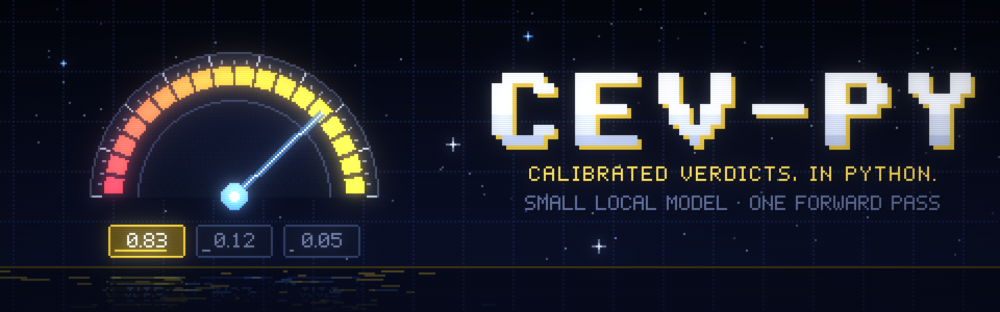

# cev-py

> Typed, calibrated decisions from a small local model, in one forward pass.

[cev](https://github.com/CarterCole/rust-cev) for Python. You give it program
state and typed questions: **is this true** (`noul`), **which of these**
(`choice`), **which level** (`score`). It gives back typed answers with
probabilities. The model never generates text, so an answer outside the
options you listed is impossible, and a request takes tens of milliseconds.

It runs Qwen3 and Qwen3.5 checkpoints with cev's own zero-shot readout, and
the open decision models natively (Bespoke **Nimble**, Jared Palmer's **Kev**,
vLLM Semantic Router's **d3**, Liquid's **d1** and **d1-omni**), including
their image and audio inputs.

This package runs the cev engine inside your Python process as a native
module: no server, no HTTP, no PyTorch. It uses the GPU on a Mac, Apple's BLAS
or all the cores on a CPU, and releases the GIL while it works. Every answer is
logged with an id, so you can send the right answer back later and the model
learns from it while it runs.

```python
from cev import Cev

cev = Cev.load("Qwen/Qwen3-1.7B")

res = cev.decide(
    {"ticket": "The app crashes when I tap Log in"},
    {
        "team": {"type": "choice", "instructions": "Which team?", "criteria": {"billing": "Payments", "tech": "Bugs and crashes"}},
        "refund": {"type": "noul", "instructions": "Is a refund requested?"},
        "severity": {"type": "score", "instructions": "How severe?", "criteria": ["Cosmetic", "Degraded", "Blocking"]},
    },
)
answers = res["answers"]

answers["team"]["choice"]          # 'tech'
answers["team"]["probabilities"]   # {'billing': 0.0, 'tech': 1.0}
answers["refund"]["noul"]          # 0.007   probability of yes
answers["severity"]["score"]       # 1.51    expected level: {'0': 0.015, '1': 0.459, '2': 0.525}

# Later, when you know the right answer:
cev.feedback(decision_id=answers["severity"]["x_cev"]["decision_id"], label=2)
```

## Install

```bash
pip install cev-py                # or: uv add cev-py
```

The distribution is called `cev-py` and the module `cev`. Wheels are built for
macOS on Apple silicon (with Metal and Accelerate) and for Linux x86_64 and
aarch64 (glibc 2.28 or later, CPU only); one wheel covers every Python from
3.11. Anywhere else pip builds from the source distribution, which needs a Rust
toolchain; for CUDA, see [Building from source](#building-from-source).

Weights are not bundled. `Cev.load` takes a Hugging Face repo id, a local
directory or a short name, and works out the model family from the files. It
looks in the Hugging Face cache first, then in `~/.cache/cev/models`, and
downloads into the latter if the model is in neither (`HF_TOKEN` is
honoured). Adapters pull their pinned base model too.

| `model` | Download | Takes | Notes |
| --- | ---: | --- | --- |
| `Qwen/Qwen3-0.6B` | 1.5 GB | text | fastest; weaker on judgement calls (it scores the login crash above as cosmetic) |
| `Qwen/Qwen3-1.7B` | 4.1 GB | text | the default |
| `Qwen/Qwen3-4B-Instruct-2507` | | text | wants a GPU |
| `Qwen/Qwen3.5-*` | | text, images | cev's zero-shot readout on the hybrid Qwen3.5 |
| `kev:0.8b`, `kev:4b`, `kev` (9B) | | text | Kev's LoRA and pointer head on Qwen3.5-Base, merged at load |
| `nimble-v3` (9B) | | text | Bespoke Nimble's LoRA and schema prompt on Qwen3.5-9B |
| `d3:2b` … `d3` (27B) | | text, images | d3's 255-way readout, attention run bidirectionally |
| `d1` (3B) | | text, images | Liquid's LFM2.5-VL decision model |
| `d1-omni` (600M) | 2.3 GB | text, images, audio | Liquid's encoder with a decision head |
| a directory | | | any of the above, a LoRA fine-tune from rust-cev's `training/train_lora.py`, or an int8 Qwen3 copy from its `quantize` example (CPU only) |

`cev.model["family"]` and `cev.model["modalities"]` say what was loaded and
what it takes. rust-cev's [Models](https://github.com/CarterCole/rust-cev#models)
section has the details and the parity checks against PyTorch.

## Questions and answers

A request is a state (free text, or anything `json.dumps` takes) and one or
more named questions. They are all answered in the same forward pass, each as
if it had been asked alone.

| `type` | Asks | `criteria` | Answer |
| --- | --- | --- | --- |
| `noul` | is this true? | optional: what counts as yes, or `{"true": ..., "false": ...}` descriptions | `noul`: probability of yes |
| `choice` | which of these? | `{name: description}`, or `[name, ...]` | `choice`, `confidence`, `probabilities` by name |
| `score` | which level? | level descriptions, lowest first | `score` (expected level index), `confidence`, `probabilities` by index, `legend` |

Up to 255 options per question and 256 questions per request. Every answer
also has `x_cev`: its `decision_id`, its `task`, and whether an online adapter
adjusted it.

Requests and responses are plain dicts with the fields of cev's REST API
(`POST /v1/systemone` and friends). The package is typed (`py.typed`): the
shapes are `TypedDict`s such as `Question`, `ChoiceAnswer` and `DecideResponse`,
importable from `cev`.

Small models favour whichever option is listed first. cev corrects for that on
every request (`debias`):

| `debias` | Does | Cost |
| --- | --- | --- |
| `none` | the raw distribution | |
| `calibrate` | subtracts what the model answers to the same question over empty evidence | free after the first request with a question |
| `permute` | averages over rotations of the option order (up to `max_permutations`) | more tokens in the pass |
| `full` | both | about 2x `calibrate` |
| `auto` (default) | `full` for zero-shot code readouts (Qwen3, Qwen3.5, Nimble), `none` for the trained decision models (Kev, d3, d1, d1-omni) | |

## Images and sound

Models with `image` or `audio` in `cev.model["modalities"]` take pictures and
sound with the request. Every question sees them, before the state. Pass a
file path (`pathlib.Path`), the file's bytes, or a base64 string, with or
without a `data:` header.

```python
from pathlib import Path

with Cev.load("d1-omni") as cev:
    res = cev.decide(
        "A customer sent this screenshot of the checkout page.",
        {
            "outcome": {"type": "choice", "instructions": "What does the screenshot show?",
                        "criteria": {"success": "The purchase went through", "failure": "Something went wrong"}},
            "needs_help": {"type": "noul", "instructions": "Does the customer need help from support?"},
        },
        images=[Path("checkout.png")],
    )
    res["answers"]["outcome"]["probabilities"]   # {'success': 0.033, 'failure': 0.967}

    cev.decide(
        "A voicemail left on the support line.",
        {"callback": {"type": "noul", "instructions": "Does the caller want a call back?"}},
        audio=Path("voicemail.wav"),
    )
```

- Images: PNG, JPEG, WebP or GIF, for `d1`, `d1-omni`, `d3` and Qwen3.5.
  Each family resizes and tiles them its own way.
- Audio: one WAV clip, for `d1-omni`. 16 kHz mono is best; other rates and
  stereo are resampled and mixed down. d1-omni takes images or audio in one
  request, not both.
- A plain `str` is always read as base64, never as a path.
- A model that does not take what you sent raises `CevError` with code `bad_request`.

## Feedback and online learning

Send the right answer back and cev stores it with the decision. With
`online_learning` (the default) it also updates a small per-task adapter on top
of the frozen model: a temperature, a bias per option and a linear probe on the
model's own hidden state.

```python
res = cev.decide(state, {"team": {"type": "choice", "instructions": "Which team?", "criteria": criteria, "task": "router.team"}})

cev.feedback(decision_id=res["answers"]["team"]["x_cev"]["decision_id"], label="billing")
# or: cev.feedback(request_id=res["request_id"], question_id="team", label="billing", comment="...", metadata={"by": "agent-7"})

cev.tasks()
# [{'task': 'router.team', 'examples': 12, 'active': True, 'base_loss': 0.71, 'adapted_loss': 0.33, ...}]
```

- A **task** is one decision you make repeatedly. Give questions a `task` name;
  without one the key is a hash of the type, instructions and option names, so
  rewording a question starts a new adapter.
- An adapter is **served only once it has `min_examples` labels and beats the
  base model** on labels it had not yet seen. Until then, and whenever it stops
  winning, you get the base model. `x_cev["adapted"]` says which one answered.
- Labels: `True`/`False` or a probability for `noul`; the option name for
  `choice`; a level index for `score` (fractions split between neighbours); or
  a full distribution `{option: probability}` for any of them.
- `cev.examples([{"state": ..., "questions": ..., "labels": ...}])` decides and
  labels in one call, for seeding a task with examples you already have.
- A **namespace** keeps feedback apart. Adapters are kept per namespace and
  task, so labels on decisions made with `namespace="acme"` only change the
  answers served with `namespace="acme"`: one per customer, say. Requests
  without one share the default namespace. `cev.tasks("acme")` and
  `cev.reset_task(task, "acme")` work on one namespace; `cev.tasks()` lists them all.

## The decision log

Pass `db="cev.db"` to keep decisions, feedback and adapters in a SQLite file
across restarts. The default is in memory. `no_store=True` on a request skips
the log (its answers then cannot take feedback).

```python
cev.decisions(task="router.team", limit=20)   # recent decisions
cev.decision(decision_id)   # {'decision', 'state', 'prompt', 'feedback'} with the exact text the model saw
cev.stats()                 # {'store': {'requests', 'decisions', 'feedback', 'labeled_decisions'}, 'tasks', 'model'}

# Training rows for an offline LoRA fine-tune (rust-cev's training/train_lora.py --source labels.jsonl)
Path("labels.jsonl").write_text(cev.export_ndjson())
rows = cev.export(labeled=False)   # the same, parsed; every decision, labelled or not
```

## API

| | |
| --- | --- |
| `Cev.load(model=None, **options)` | load a model |
| `Cev.mock(**options)` | a keyword-overlap stand-in: no weights, instant, the whole API works. For tests |
| `cev.model` | `{'id', 'backbone', 'family', 'modalities', 'hidden_size', 'max_options', 'prompt_version', 'threads', 'concurrency'}` |
| `cev.decide(state, questions, *, images=None, audio=None, namespace=None, debias=None, no_store=False)` | answer the questions |
| `cev.feedback(*, decision_id=None, request_id=None, question_id=None, label=None, weight=None, comment=None, metadata=None)` | label or comment on an answer |
| `cev.examples(examples)` | decide, then learn from the labels; each example may carry `images`, `audio` and `namespace` |
| `cev.tasks(namespace=None)` / `cev.reset_task(task, namespace=None)` | adapter status / drop an adapter (its labels stay) |
| `cev.decisions(*, task=None, namespace=None, limit=50, offset=0)` / `cev.decision(decision_id)` | read the log |
| `cev.export(...)` / `cev.export_ndjson(...)` | training rows; filter by `task`, `namespace`, `model`, `labeled`, `since`, `limit` |
| `cev.stats()` | counts |
| `cev.close()` | free the model once the calls in flight have returned; `with Cev.load(...) as cev:` does it for you |
| `info()` (`from cev import info`) | what the module was built with: `{'version', 'metal', 'accelerate', 'cuda', 'cores', 'performance_cores', 'threads'}` |

### Options

| Option | Default | |
| --- | --- | --- |
| `model` | `Qwen/Qwen3-1.7B` | Hugging Face repo id, a directory, or a short name (`kev:0.8b`, `d1-omni`, ...); see [Install](#install) |
| `device` | `auto` | `auto` (Metal, then CUDA, then CPU), `cpu`, `metal`, `cuda` |
| `dtype` | `auto` | `f32` on CPU and for checkpoints up to 4 GB on Metal, else `bf16`; or `f16` |
| `threads` | performance cores | CPU threads for the tensor kernels; see [Performance](#performance) |
| `concurrency` | `1` | forward passes that may run at once |
| `db` | `:memory:` | SQLite file for the log |
| `debias` | `auto` | default for requests that do not set it |
| `max_permutations` | `4` | most option rotations per question |
| `online_learning` | `True` | when false, labels are stored but nothing adapts |
| `min_examples` | `8` | labels before an adapter may be served |
| `store_features` | `True` | keep hidden states with decisions; learning from later feedback needs them |
| `max_context` | `32768` | longest prompt in tokens (capped by the model) |
| `prefix_cache_tokens` | `65536` | tokens of state prefixes kept for reuse |
| `name` | `cev-<model>` | the `model` reported in responses |

`Cev.mock` takes the options from `db` to `store_features`, and `media=True`
to accept images and audio (it is text-only otherwise, like Qwen3).

### Errors

Every failure is a `cev.CevError` with a `code`:

| `code` | Means |
| --- | --- |
| `bad_request` | the call was malformed: no questions, one option, a label that is not an option, images or audio the model does not take |
| `not_found` | no such decision (was it made with `no_store`?) |
| `closed` | the instance was closed |
| `internal` | everything else: missing weights, a failed download, I/O |

Set `CEV_LOG=debug` to print the engine's log, including the time each pass
spent tokenizing, prefilling and answering, to stderr.

## Threads and asyncio

Every method releases the GIL while it works, so you can call one `Cev` from
many threads. Forward passes take turns (`concurrency` at a time); feedback and
log reads do not wait for them.

```python
with ThreadPoolExecutor(8) as pool:
    results = list(pool.map(lambda ticket: cev.decide(ticket, questions), tickets))

# asyncio: the call blocks its thread, not the event loop
res = await asyncio.to_thread(cev.decide, state, questions)
```

## Performance

Qwen3-0.6B, f32, on an Apple M4 Max (12 performance and 4 efficiency cores).
The request is the one rust-cev benchmarks with: a short ticket and 3 questions
(270 tokens with `calibrate`, 570 with `full`). "New state" is a state the
model has not seen; "same state" repeats it, so its prefix comes from the
cache. Median latency of one request at a time, in milliseconds:

| | `calibrate`: new / same state | `full`: new / same state | 3k-token state, `calibrate`: new / same |
| --- | ---: | ---: | ---: |
| CPU | 183 / 131 | 394 / 335 | 3425 / 359 |
| Metal | 46 / 35 | 88 / 77 | 603 / 68 |

Qwen3-1.7B on Metal: 97 / 69 and 182 / 158. The very first request with a
question costs about twice a new state (its calibration is computed once and
cached). Loading takes about half a second once the weights are in the page
cache. Reproduce with
`uv run python scripts/bench.py --model Qwen/Qwen3-0.6B --device cpu`.

### What the cores are doing

- **On a Mac, use Metal** (`device="auto"` does). It is 4 to 6 times faster
  than the CPU on the same machine.
- **On the CPU, a pass runs on a pool of `threads` threads**: the matmuls
  through Apple's Accelerate on macOS and through multi-threaded portable
  kernels elsewhere, the element-wise work (softmax, norms, rotary embedding)
  split over the pool. The default is the performance cores; efficiency cores
  slow a pass down because work is split evenly and everyone waits for the
  slowest. `RAYON_NUM_THREADS` or `threads` overrides it. The pool belongs to
  the process, so only the first `Cev.load` sets its size.
- **More threads stop helping a single request early on Apple silicon.** About
  70% of a CPU pass is matmul that Accelerate already runs at the chip's limit
  (about 1.9 TFLOP/s on the M4 Max), and that part does not scale with threads.
  With Qwen3-0.6B a short request with a new state takes 254 ms on 1 thread,
  188 on 4, 180 on 8 and 183 on 12.
- **For throughput on the CPU, raise `concurrency`** and call from several
  threads. Several passes side by side use what one pass leaves idle: with 8
  threads calling, Qwen3-0.6B goes from 5.4 to 10.6 requests/s at
  `concurrency=8`. Each request gets slower, so leave it at 1 if latency
  matters more. On a GPU the passes queue on the device anyway (21 requests/s
  on Metal): keep it at 1.
- **Ask your questions together.** One request with 12 questions is cheaper
  than 4 requests with 3 each, and the state is read once.
- **Keep the state prefix stable.** A request whose state was seen before skips
  straight to the questions. The cache matches on the rendered state, so put
  what changes last.
- `calibrate` is half the cost of `full` if you can live without the rotation
  averaging.

## Building from source

```bash
uv sync                              # builds the module (release) into .venv, with pytest
uv run pytest                        # mock backend; no weights needed
CEV_TEST_MODEL=Qwen/Qwen3-0.6B uv run pytest   # also run a real model
uv run maturin develop --release     # rebuild after changing src/lib.rs
uv run maturin develop --release --features cuda   # NVIDIA GPUs (needs the CUDA toolkit)
uv run python scripts/bench.py --model Qwen/Qwen3-0.6B --device cpu
```

To build against an engine checkout instead of crates.io (with rust-cev next
to this repository):

```bash
uv run maturin develop --release \
  --config 'patch.crates-io.cev-core.path="../rust-cev/crates/cev-core"' \
  --config 'patch.crates-io.cev-model.path="../rust-cev/crates/cev-model"' \
  --config 'patch.crates-io.cev-runtime.path="../rust-cev/crates/cev-runtime"'
```

- `src/lib.rs` is a small Rust crate (PyO3) that links the cev crates from
  crates.io (`Cargo.toml`); `python/cev/` is the Python API on top of it.
- The module uses the stable ABI (`abi3`), so one build serves Python 3.11 and
  later.
- Only macOS on Apple silicon is tested so far. The same engine builds and
  passes its mock-backend tests on Linux x64 through node-cev's CI; this
  package has not been built there yet, and Windows is untried.

## How this relates to rust-cev

[rust-cev](https://github.com/CarterCole/rust-cev) is the project: the prompt
compiler, the engines for Qwen3, Qwen3.5 and the decision models, the decision log, the online learner, an HTTP and
GraphQL server, a browser build and a typed Rust SDK. This repository is only
the Python binding (about 300 lines of Rust glue and a typed wrapper), and
none of the engine is copied here. The same binding for Node.js is
[node-cev](https://github.com/neopunisher/node-cev). If you would rather run a
server and call it over HTTP, use `cev-server` from rust-cev; its
`/v1/systemone` takes the same request this package's `decide` builds.

## License

Apache-2.0, like cev.
